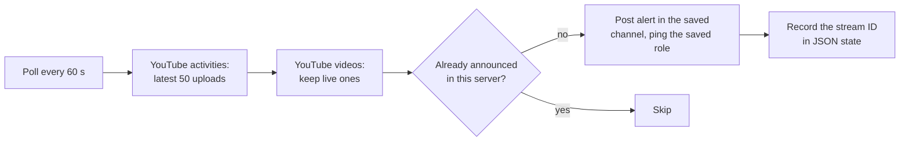

# Discord notification bot

A Discord bot that posts an alert when a YouTube channel goes live. It polls the
YouTube Data API v3 every 60 seconds. When it finds a new livestream, it posts one
message in a chosen channel. The message pings a chosen role and links to the
stream on YouTube and Twitch.

**Tech:** Python 3.12+, discord.py (slash commands), aiohttp, YouTube Data API v3,
Docker Compose, `unittest`.


## What it does

- Checks one YouTube channel for active livestreams every 60 seconds.
- Posts each stream once per Discord server. It remembers the last 100 announced
  stream IDs, so a restart does not repeat old alerts.
- Has four slash commands, for server administrators only:
  - `/set-channel` picks the text channel for alerts.
  - `/set-role` picks the role to ping.
  - `/test-live` sends a test alert through the same code path as real streams.
  - `/ping` checks that the bot is responding.
- Saves state as JSON with atomic writes. Under Docker Compose the files live in a
  named volume, so settings survive restarts and rebuilds.
- Keeps the API key out of logs and error messages.

**Limits:**

- Twitch is a link in the alert, not a separate live detector. Only YouTube is checked.
- X/Twitter integration is not implemented.
- Alerts depend on YouTube's activity feed, so they are not guaranteed to be real time.
  Indexing delays can delay or miss an alert.

See [docs/design.md](docs/design.md) for how state, retries and duplicate
prevention work.

## Quick start

You need a Discord bot token, a YouTube Data API v3 key, your YouTube channel ID
(it starts with `UC`), and your Twitch URL.
[docs/setup.md](docs/setup.md) shows how to get each one and which Discord
permissions the bot needs.

With Docker Compose:

```sh
git clone https://github.com/Risa-Miura/youtube-live-discord-bot.git
cd youtube-live-discord-bot
cp .env.example .env    # then fill in your own values; never commit .env
docker compose up -d --build
docker compose logs -f
```

Then, as a server administrator in Discord:

1. Run `/set-channel` and pick the alert channel.
2. Run `/set-role` and pick the role to ping.
3. Run `/test-live` to send a test alert. It really pings that role.

To run it without Docker, see [Run locally](docs/setup.md#run-locally). To deploy on
a VM, see [docs/deployment.md](docs/deployment.md).

## Run the tests

The tests make no live API calls and never read your real `.env`.

```sh
python -m venv .venv
.venv/bin/pip install -r requirements.txt          # Windows: .venv\Scripts\pip install -r requirements.txt
.venv/bin/python -m unittest discover -s tests -v   # Windows: .venv\Scripts\python -m unittest discover -s tests -v
```

If the virtual environment is activated, the test command is just
`python -m unittest discover -s tests -v`.

The 22 tests cover:

- configuration loading and the exact alert text
- role-mention restrictions and administrator-only commands
- duplicate prevention across restarts and concurrent sends
- retries after a failed Discord send
- live-video filtering, API failures and error sanitizing
- saving the alert channel for each server

## How it works



```text
bot.py                 # Entry point, Discord connection, startup and shutdown
commands.py            # Administrator-only command tree and slash commands
config.py              # Environment loading and settings
notifications.py       # Shared alert formatting and delivery
state.py               # Validated JSON storage and atomic file replacement
monitors/
    __init__.py
    youtube.py         # YouTube requests and background polling
tests/
    test_bot.py        # Offline regression tests
    test_channels.py   # Administrator access and persistent notification destinations
docs/                  # Setup, deployment and design notes
.env.example           # Configuration template (no credentials)
requirements.txt
Dockerfile
compose.yaml           # Docker Compose service and persistent state volume
.dockerignore
```

Runtime files are ignored by Git: `role_config.json` holds the role and channel for
each server, and `youtube_state.json` remembers announced streams.

## More documentation

- [docs/setup.md](docs/setup.md): Discord and YouTube setup, permissions,
  environment variables, and running from source.
- [docs/deployment.md](docs/deployment.md): Docker Compose on a Google Cloud VM,
  everyday commands, migration, and rollback.
- [docs/design.md](docs/design.md): state storage, duplicate prevention, failure
  handling, and detector limits.
