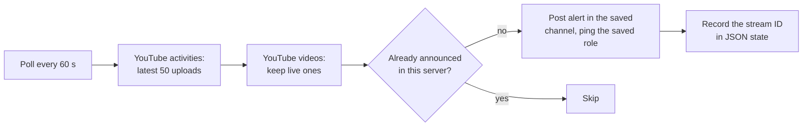

# youtube-live-discord-bot 🔔

A little Discord bot for streamers' servers. When a YouTube channel goes live, it
posts a message in the channel you pick, pings the role for people who want alerts,
and links to the stream on YouTube and Twitch.


It's written in Python with discord.py and aiohttp, and runs with Docker Compose.
Every 60 seconds it asks the YouTube Data API v3 whether the channel is live. It remembers the
last 100 streams it announced in each server, so restarting it doesn't ping everyone
again.

It only watches YouTube for now. The Twitch part is just a link in the message. And
since it reads YouTube's activity feed, an alert can sometimes show up late.

## Commands

Only server admins can use these:

- `/set-channel` picks where alerts go
- `/set-role` picks which role gets pinged
- `/test-live` sends a test alert (it really pings the role!)
- `/ping` checks that the bot is awake

## Setup

You'll need a Discord bot token, a YouTube Data API v3 key, your YouTube channel ID
(the one starting with `UC`), and your Twitch URL. [docs/setup.md](docs/setup.md)
walks through getting those and the permissions the bot needs in Discord.

```sh
git clone https://github.com/Risa-Miura/youtube-live-discord-bot.git
cd youtube-live-discord-bot
cp .env.example .env    # fill in your own values, and never commit .env
docker compose up -d --build
docker compose logs -f
```

Then in Discord, run `/set-channel`, then `/set-role`, then `/test-live` to check it works.

To run it without Docker, see [Run locally](docs/setup.md#run-locally). The steps for
running it on a Google Cloud VM are in [docs/deployment.md](docs/deployment.md).

## Tests

The tests don't call any real APIs or read your `.env`.

```sh
python -m venv .venv
.venv/bin/pip install -r requirements.txt
.venv/bin/python -m unittest discover -s tests -v
```

On Windows, use `.venv\Scripts\` instead of `.venv/bin/`.

They check the alert message, admin-only commands, no double posts after a restart,
retrying when Discord fails, and keeping the API key out of error messages.

## How it works



`bot.py` starts everything up, `monitors/youtube.py` does the polling,
`notifications.py` writes and sends the alert, `commands.py` has the slash commands,
and `state.py` saves settings and announced streams as JSON. If you're curious how
it avoids duplicates and handles failures, that's in [docs/design.md](docs/design.md).
